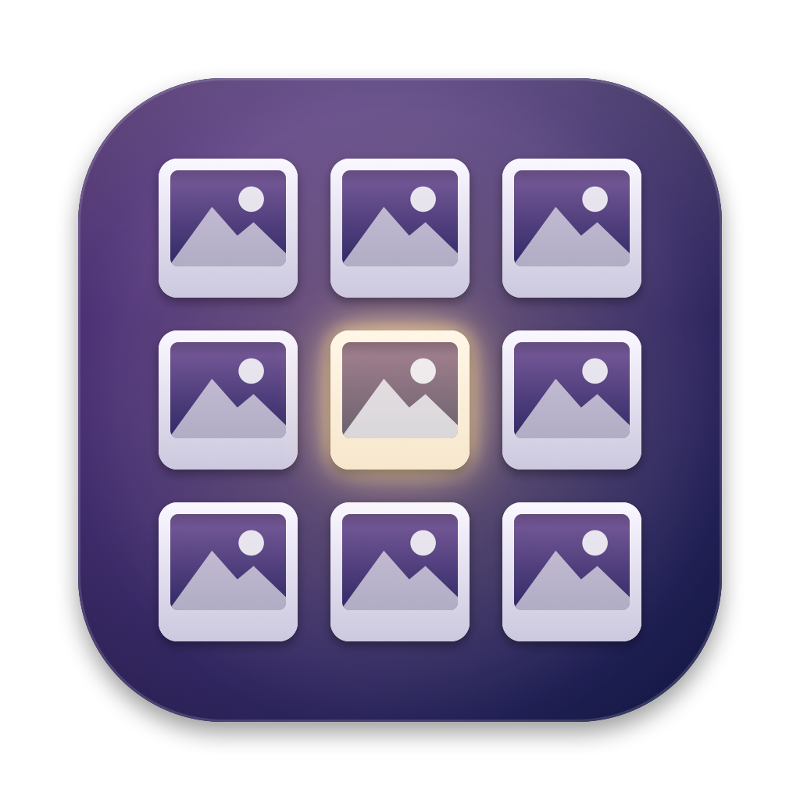

<h1 align="center">PhotoBoard</h1>

Tavolo luminoso per studiare, ordinare ed esporre sequenze fotografiche · macOS 14 o successivo 
A light table for studying, sequencing and presenting photographs · macOS 14 or later

<a href="https://github.com/alecensi82/PhotoBoard/releases/latest/download/PhotoBoard.dmg"><b>⬇︎ Scarica PhotoBoard / Download PhotoBoard</b></a>

---

## Italiano

PhotoBoard è un tavolo luminoso per fotografi: metti le foto su un piano infinito, raggruppale in aree, costruisci la sequenza nella Storyline, confronta le immagini e presentale a schermo intero.

- **Tavolo luminoso** con aree, tag colorati, stelle, bandierine, copie virtuali, commenti e appunti disegnati.
- **Storyline** con capitoli e didascalie, e analisi della sequenza (ritmo, apertura, chiusura, passaggi mancanti).
- **Analisi** di luce, colore e composizione di ogni foto, e coerenza della serie.
- **Confronto A/B, dittico e trittico** dentro la finestra del progetto.
- **Foto aperta** con zoom fino al 400%, a piena risoluzione.
- **Esportazioni**: cartelle numerate, storyboard PDF, Story Map, pagina web, rinomina in blocco, XMP per Lightroom e Capture One.
- In **italiano** e **inglese**. Le foto restano sul tuo Mac: nessun dato viene inviato in rete.

### Installazione
1. Scarica **PhotoBoard.dmg** dalla pagina [Releases](../../releases/latest).
2. Aprilo e trascina **PhotoBoard** in **Applicazioni**.

L'app è firmata con Developer ID e notarizzata da Apple: si apre senza avvisi.

### Licenza
PhotoBoard è gratuito per uso personale e professionale. Non è consentito ridistribuirlo o modificarlo. Vedi [LICENSE.txt](LICENSE.txt).

---

## English

PhotoBoard is a light table for photographers: lay your photos on an infinite board, group them into areas, build the sequence in the Storyline, compare images and present them full screen.

- **Light table** with areas, colour tags, stars, flags, virtual copies, comments and drawn notes.
- **Storyline** with chapters and captions, plus sequence analysis (rhythm, opening, closing, missing transitions).
- **Analysis** of light, colour and composition for every photo, and series coherence.
- **A/B compare, diptych and triptych** inside the project window.
- **Open photo** with zoom up to 400%, at full resolution.
- **Exports**: numbered folders, PDF storyboard, Story Map, web page, batch rename, XMP for Lightroom and Capture One.
- In **Italian** and **English**. Your photos stay on your Mac: no data is sent over the network.

### Installation
1. Download **PhotoBoard.dmg** from the [Releases](../../releases/latest) page.
2. Open it and drag **PhotoBoard** into **Applications**.

The app is signed with Developer ID and notarised by Apple, so it opens without warnings.

### Licence
PhotoBoard is free for personal and professional use. Redistribution and modification are not permitted. See [LICENSE.txt](LICENSE.txt).

---

© 2026 Alessandro Censi · [www.alessandrocensi.it](https://www.alessandrocensi.it)
